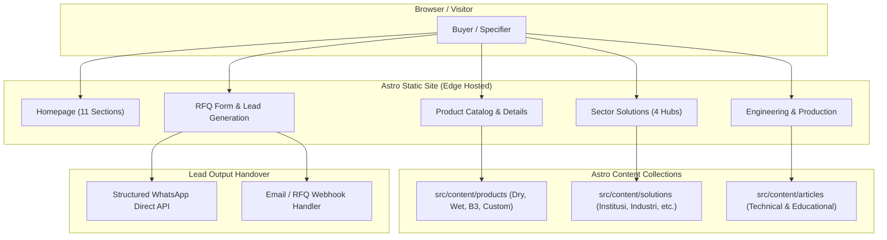

# PLAN: AtasiLimbah Web Architecture & Implementation

## Architecture
AtasiLimbah is built as an ultra-fast, static-first Astro 5 application with pre-rendered pages, structured content collections, and zero-runtime client bloat. Interactive components (such as the RFQ form with client validation and payload formatting) are implemented as minimal island components.

## Platforms & Hosting
- Runtime: Node.js (build-time SSG)
- Target Hosting: Cloudflare Pages (Global CDN, sub-50ms TTFB worldwide)
- Limits: Pure static output (`dist/`), zero server cold starts, 100% cacheable edge delivery.

## Auth, Roles & Authorization
Not applicable — Phase 1 is a public B2B corporate profile, technical product catalog, and lead generation surface. No public user accounts or authenticated member sessions are required.

## Security & Privacy
- Form Protection: Honeypot field and client-side parameter sanity check on the RFQ form to prevent automated spam bot submissions.
- Data Privacy: Clear consent agreement checkbox (`Persetujuan penggunaan data`) before submitting procurement specs.
- Safe Content: No external unverified scripts; strict local font and asset bundling to eliminate third-party tracking vulnerabilities.

## Performance & Reliability Targets
| Target | Value | Linked requirement | How measured |
|---|---|---|---|
| First Contentful Paint (FCP) | < 1.0s | REQ-010 | Chrome DevTools / Lighthouse |
| Largest Contentful Paint (LCP) | < 1.8s | REQ-010 | Chrome DevTools / Lighthouse |
| Cumulative Layout Shift (CLS) | < 0.05 | REQ-010 | Chrome DevTools / Lighthouse |
| SEO Checklist Compliance | 100% pass | REQ-010 | `node scripts/check-seo.mjs` |

## Environments & Delivery
- Local: Astro dev server (`npm run dev`) at port 4321.
- Staging/Preview: Cloudflare Pages preview builds on pull requests / branch push.
- Production: Cloudflare Pages custom domain (`atasilimbah.com`).

## Data Schema (Content Collections)

### Products Collection (`src/content/products/`)
| Field | Type | Required | Description |
|---|---|---|---|
| id / slug | string | yes | Unique ASCII slug (`incinerator-sampah-kering-100`, etc.) |
| title | string | yes | Product display name |
| category | string | yes | `kering` \| `basah` \| `b3` \| `custom` |
| modelCode | string | yes | Engineering model identifier (e.g. `AL-DK100`) |
| nominalCapacity | string | yes | e.g. `100 kg/jam` |
| testedCapacity | string | yes | e.g. `80 - 100 kg/jam` |
| wasteTypes | string[] | yes | Supported waste types (kertas, kardus, kain, dll.) |
| dimensions | string | yes | Dimensions (P x L x T mm) |
| constructionMaterial | string | yes | Firebrick refractory, insulation, mild steel shell |
| combustionSystem | string | yes | Single/Dual Chamber, controlled air |
| fuelType | string | yes | Solar / Gas / Listrik |
| fuelConsumption | string | yes | Liter/jam or kg/jam estimate |
| electricPower | string | yes | e.g. `2.2 kW, 220/380V` |
| emissionControl | string | yes | Wet scrubber / cyclone / water spray |
| emissionTestStatus | string | yes | Document status / verification |
| safetyFeatures | string[] | yes | Emergency stop, temperature interlock, etc. |
| disclaimer | string? | no | Regulatory or pre-treatment notice (mandatory for B3/Wet) |

### Solutions Collection (`src/content/solutions/`)
| Field | Type | Required | Description |
|---|---|---|---|
| title | string | yes | Sector name (e.g. Solusi Sampah Institusi & Pendidikan) |
| slug | string | yes | e.g. `solusi-sampah-institusi` |
| targetFacilities | string[] | yes | Pesantren, sekolah, kampus, asrama |
| commonIssues | string[] | yes | Key waste challenges in this sector |
| recommendedSystems | string[] | yes | Recommended incinerator categories/models |
| benefits | string[] | yes | Operational and financial advantages |

## Integrations & Contracts
- **RFQ Submission Pipeline**:
  Form collects:
  1. Full Name (`nama`)
  2. Company / Institution (`perusahaan`)
  3. WhatsApp Number (`whatsapp`)
  4. Email (`email`)
  5. City / Project Location (`lokasi`)
  6. Machine Category (`kategori_mesin`)
  7. Waste Type Description (`jenis_sampah`)
  8. Hazardous (B3) Classification if applicable (`klasifikasi_b3`)
  9. Estimated Daily Volume (`volume_harian`)
  10. Operating Hours (`jam_operasional`)
  11. Timeframe / Timeline (`jadwal_pembelian`)
  12. Additional Notes (`catatan`)
  13. Consent Confirmation (`persetujuan`)
- Action: Generates a pre-formatted, structured WhatsApp consultation message directly to the engineering team and optionally triggers email delivery via form handler / Cloudflare Worker.

## Risks & Mitigations
- **Risk: Regulatory sensitivity around B3 incinerators.**
  - Mitigation: Prominent disclaimer on all B3 pages stating that machine supply does not substitute for customer environmental permits (AMDAL/UKL-UPL/B3 operational permit from KLHK).
- **Risk: Unrealistic user expectations on burning high-moisture organic waste.**
  - Mitigation: Explicit guidance on wet waste pages explaining that direct combustion of soaked organic waste without pre-sorting/drying causes incomplete combustion, smoke, and fuel waste.
